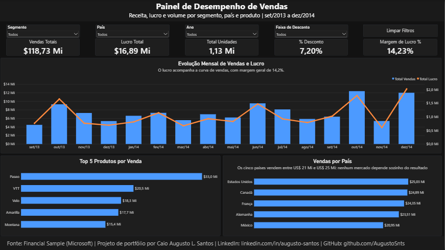
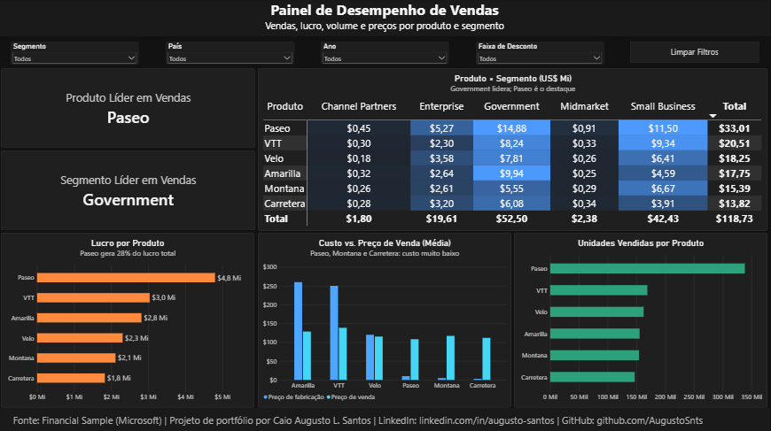
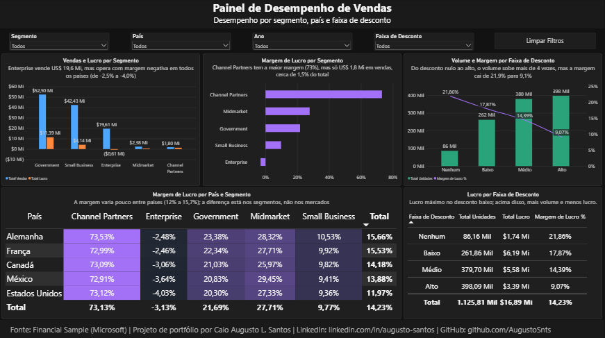

# Painel de Desempenho de Vendas | Power BI

Dashboard interativo em três páginas que analisa vendas, lucro, volume e descontos a partir do dataset *Financial Sample* da Microsoft (set/2013 a dez/2014).

**Autor:** Caio Augusto de Lima Santos
**LinkedIn:** [linkedin.com/in/augusto-santos](https://linkedin.com/in/augusto-santos)
**GitHub:** [github.com/augustosnts](https://github.com/AugustoSnts)

## Objetivo

Responder perguntas de negócio sobre desempenho comercial:

- Como evoluem vendas e lucro ao longo do tempo?
- Quais produtos, segmentos e países mais contribuem para o resultado?
- Qual a rentabilidade de cada segmento e de cada país?
- O volume extra gerado por descontos compensa a perda de margem?

## Páginas do painel

### 1. Visão Geral
KPIs principais (vendas, lucro, unidades, % de desconto e margem), evolução mensal de vendas e lucro, Top 5 produtos e vendas por país.



### 2. Análise de Produtos
Produto e segmento líderes, matriz Produto × Segmento com mapa de calor, lucro e unidades por produto e comparação entre custo de fabricação e preço de venda.



### 3. Segmentos e Países
Vendas, lucro e margem por segmento, matriz de margem País × Segmento e análise do impacto das faixas de desconto sobre volume, margem e lucro.



## Principais achados

- **Resultado geral:** US$ 118,73 Mi em vendas, US$ 16,89 Mi em lucro e margem de 14,23%.
- **Concentração em Government:** o segmento soma US$ 52,50 Mi, cerca de 44% das vendas.
- **Paseo é o produto líder:** US$ 33,01 Mi em vendas e cerca de 28% do lucro total.
- **Enterprise opera com margem negativa:** vende US$ 19,61 Mi, mas tem lucro negativo (cerca de -US$ 0,61 Mi) e margem negativa em todos os países.
- **Channel Partners tem a maior margem (73%)**, mas representa só cerca de 1,5% das vendas.
- **Descontos:** do desconto nulo ao alto, o volume sobe mais de 4 vezes, mas a margem cai de 21,9% para 9,1%. O maior lucro absoluto está na faixa de desconto **baixo** (US$ 6,19 Mi); em faixas maiores, mais volume não se converte em mais lucro.
- **Países:** as vendas ficam entre US$ 20,95 Mi e US$ 25,03 Mi e a margem varia pouco entre eles (cerca de 12% a 15,7%); a diferença está nos segmentos.

> Observação: são associações observadas nos dados, não relações de causa e efeito.

## Recomendações

- Investigar Enterprise: vende US$ 19,6 Mi com margem negativa; revisar preço, custo e descontos.
- Rever descontos médios e altos: o lucro é máximo no desconto baixo.
- Reduzir a dependência de Government e Paseo.
- **Testar a expansão de Channel Partners, que tem a maior margem.
  
## Metodologia

**Tratamento de dados (Power Query / M)**
- Promoção de cabeçalhos e limpeza de espaços nos nomes de colunas (`Text.Trim`).
- Definição de tipos de dados.
- Renomeação de colunas e tradução de países e faixas de desconto para português.
- Criação de coluna de ordenação para as faixas de desconto.

**Modelagem (DAX)**
- Tabela calendário relacionada à coluna de data da tabela de fatos.
- Medidas: Total Vendas, Total Lucro, Total Unidades, Margem de Lucro % (`DIVIDE(lucro, vendas)`), % Desconto, Produto Líder e Segmento Líder.

**Visualização**
- Paleta com significado fixo: azul = vendas, laranja = lucro, verde = unidades, roxo = margem.
- Slicers sincronizados entre páginas (Segmento, País, Ano, Faixa de Desconto) e botão para limpar filtros.
- Mapas de calor em matrizes e frases de análise em cada página.

## Como abrir o projeto

1. Baixe o arquivo `.pbix` deste repositório.
2. Abra no [Power BI Desktop](https://powerbi.microsoft.com/desktop/) (gratuito, Windows).
3. Os dados já ficam salvos no arquivo, então o painel abre normalmente. Para atualizar a partir da planilha, baixe o `Financial Sample.xlsx` (aba `Sheet1`) e aponte para ele em **Transformar dados** > **Configurações da fonte de dados** > **Alterar origem**.

## Estrutura do repositório

```
├── Projeto1_PowerBI.pbix
├── Financial Sample.xlsx
├── imagens/
│   ├── pagina1.png
│   ├── pagina2.png
│   └── pagina3.png
└── README.md
```

## Fonte dos dados

*Financial Sample*, dataset de exemplo disponibilizado pela Microsoft. Os dados são fictícios e usados apenas para fins de estudo e portfólio.

## Ferramentas

Power BI Desktop · Power Query (M) · DAX
